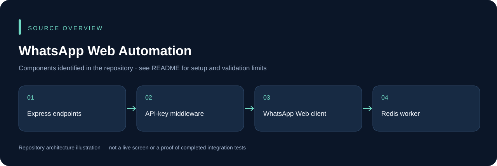

# WhatsApp Web Automation

A self-hosted WhatsApp Web invoice/messaging HTTP service built with Express and `whatsapp-web.js`. The repository includes API-key middleware and a separate Redis/BullMQ queue worker.

## Setup

```powershell
npm ci
npm start
```

Read `src/config.js`, configure the required environment variables locally and protect API credentials. The `/health` route distinguishes the HTTP service from the WhatsApp client's ready state. Pair the intended account through its current QR flow; no phone was paired and no message was sent for this repository review.

Use the source in `src/routes.js` for exact request contracts. Redis/worker scripts are a separate runtime path; do not assume starting the HTTP server automatically provides durable queued delivery. `npm run dev` runs the existing development entry, and PM2 commands are defined in `package.json`.

Browser profiles, QR output, cached WhatsApp HTML and `sessions.json` are runtime state, not source assets. Store them privately. This integration is independent of Meta's hosted WhatsApp Cloud API and requires its own device/platform testing.

## Source overview



This diagram is derived from the repository structure; it is not an application screenshot.

## Development and validation

Use an isolated development database and synthetic records. Keep credentials, device sessions, signing keys and operational uploads outside Git. The presence of source code does not establish that every integration or deployment scenario has been tested. See [repository review](docs/REPOSITORY_REVIEW.md) for this audit's scope.

## Ownership and contributions

Existing author, template, asset and dependency attributions remain in place. Follow any existing license files; this documentation update does not grant a new license. For a change, describe the affected workflow, configuration and checks so it can be reviewed without guessing.
