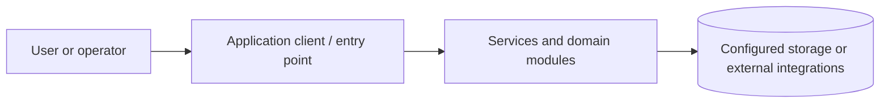

# WhatsApp Web Automation — Invoice Messaging Service

> **Status:** Source-reviewed documentation draft. Runtime startup, end-to-end tests and screenshots have **not** been independently verified. Review PR before merging.

A Node.js service for WhatsApp invoice delivery with API routes, worker/queue modules, QR session handling and PM2 configuration.

## Repository map

- `src/app.js` — HTTP application.
- `src/routes.js` — routes.
- `src/whatsappClient.js` — WhatsApp client.
- `src/queue.js`, `src/worker.js` — background jobs.
- `ecosystem.config.js` — PM2 configuration.

## Technology

Node.js, Express, whatsapp-web.js, BullMQ, Redis, Puppeteer, PM2.

## Getting started

### Prerequisites

Install the runtime and tools relevant to this project (Node.js/npm, Python, .NET SDK, mobile SDK, or desktop runtime). Use the package manifest and lockfile to determine exact compatible versions. Obtain required databases and API credentials from your own provider accounts; never commit secrets.

### Install and run

`npm ci && npm run dev` for development, or `npm start` for normal startup. Requires service configuration, WhatsApp session authorization and any queue dependencies.

> These commands are derived from repository manifests, not confirmed by an end-to-end launch. If startup fails, inspect the relevant service's environment variables, dependency versions and logs.

## Architecture and data flow

This is a **conceptual overview**, not a verified deployment topology. The directory map above identifies the actual code areas to inspect for detailed component boundaries.

## Validation and troubleshooting

1. Confirm compatible runtime versions and install dependencies using the checked-in lockfiles.
2. Supply local environment variables through ignored files or a secrets manager.
3. Start required database, queue, mobile emulator or API dependencies.
4. Run scripts declared in the package manifests; record exit codes and failing commands.
5. Verify a complete user workflow with **non-sensitive demo data**.
6. Capture screenshots only after successfully launching the real application.

If you see a connection error, verify service endpoints and credentials without printing secrets. If a native build fails, verify platform SDK versions and native dependencies. Never treat a successful dependency installation as proof that the app works.

## Screenshots

**Not captured yet.** Genuine screenshots will be added under `docs/screenshots/` only after launching the application. Each screenshot will include its screen name, purpose, relevant workflow, capture platform and verification status. Do not substitute generated mockups for runtime evidence.

## Security and maintenance notes

**Security review required:** tracked `sessions.json` and `qr-code.html` may contain session or pairing information. Do not publish live session material or screenshots of QR codes. Use only authorized accounts.

Review dependency advisories, license terms, authorization boundaries, sensitive files and third-party integrations before public deployment.

## Contributing

Open an issue with a reproducible description. Work on a feature branch, keep changes focused, update tests and docs, and request review through a pull request. Do not include credentials, customer data or personal information in issues or screenshots.

## Documentation status

- [x] Purpose and source-derived architecture overview
- [x] Repository map and initial run instructions
- [x] Security and operational caveats
- [ ] Clean-environment startup verified
- [ ] End-to-end workflow tested
- [ ] Real screenshots captured and reviewed
- [ ] Production readiness assessed

For the detailed verification checklist see [docs/PORTFOLIO_AUDIT.md](docs/PORTFOLIO_AUDIT.md).
